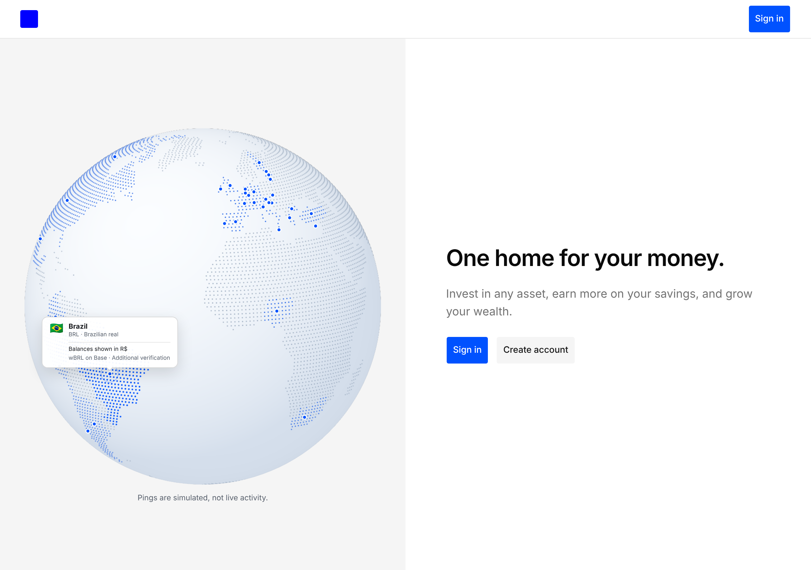

# Globe: make the landing globe do something

Status: done. Branch `design/globe`, cut from upstream/main 87d35c1.

One idea for the landing: the globe shows where Home works, and what it offers there.

## What changed

1. **Supported countries light up.** Land dots inside the 39 configured countries (from `regionIds` / `presentationRegions` in `apps/web/config/regions.ts`) are tinted with the existing `--globe-route` token in the WebGL pass. Real country shapes, not glows: a new build-time asset assigns a Natural Earth country code to every land dot (`globe-land-countries.json`, 15 KB raw, 1.7 KB gzip, 7,612 of 7,623 dots assigned). The tint fades in over 400 ms once, instantly under reduced motion. Malta, Singapore, Cyprus and Luxembourg have no dots at 1:110m and keep their marker.
2. **Hover, tap or focus a country to see the offer.** The readout expands with two quiet lines read from the region config: `Balances shown in R$` and `wBRL on Base · Additional verification` (candidate asset symbol and its verification status). Issuer names are deliberately left out (jam rule: no real company names). The country's dots brighten and grow 30% over 240 ms. Mouse hover activates and leaving clears; tap and keyboard focus work as before. Rotation pauses while a country is active.
3. **Simulated activity pings.** Up to four rings at a time, at configured countries, one every 700 ms with up to 200 ms jitter, each living 1,600 ms. Selection is a pure, deterministic hash of time (`globe-activity.ts`), grouped by currency so the 21 euro-area countries do not take most of the pings. No network, no chain reads, no addresses, no amounts. The figure carries a visible caption, "Pings are simulated, not live activity.", and the screen-reader description says the same. Under reduced motion there are no pings and no caption.
4. **Routes off on the landing.** The illustrative route arcs and the pings told the same story twice. The landing now passes `showRoutes={false} simulatedActivity`; routes still exist for anyone who wants them (Storybook `IllustrativeRoutes`).
5. **44 px touch targets** on coarse pointers (was 26 to 28 px), per the review session's note.
6. **The globe follows the brand.** `--globe-route` now reads `--primary` in light mode too (it was a fixed `#0000ff`), and the renderer resolves any CSS colour (hex, `oklch`, named) through a 1 by 1 canvas instead of accepting only 6-digit hex. An operator primary now tints markers, pings and lit countries for free. Proof with an `oklch` green primary: `shots/globe/themed-primary-oklch.png`.

Files: `apps/web/client/landing/{globe-activity.ts, globe-land-countries.json, globe-renderer.ts, globe-geometry.ts, supported-globe.tsx, supported-globe.module.css, generate-globe-assets.py, README.md, GEOGRAPHY.md}`, `apps/web/app/page.tsx`, story `apps/web/stories/explorations/landing-globe.stories.tsx` (SimulatedPings, IllustrativeRoutes, CountryOffer with a play test).

## Shots

- Before: `shots/globe/before-desktop.png`, `before-390.png`, `before-desktop-dark.png`
- After, idle: `shots/globe/after-desktop.png`, `after-390.png`, `after-desktop-dark.png`
- Hover offer: `shots/globe/hover-desktop.png`, `hover-desktop-dark.png`
- Operator primary (`oklch(0.55 0.15 150)`) applied: `shots/globe/themed-primary-oklch.png`
- Tap at 390: `shots/globe/tap-390.png`
- Reduced motion at 390: `shots/globe/after-390-reduced-motion.png` (no pings, no caption, tint shown instantly)
- Recording: `shots/globe/globe-interaction.mp4` (1.2 MB, H.264, 19 s: pings, then hover Brazil, Nigeria, Spain). A 9 s GIF came to 2.5 MB, so only the MP4 is committed to keep the folder near the 3 MB budget.

At 390 wide: no horizontal scroll (`scrollWidth` 390), the expanded card stays inside the stage, targets measure 44 by 44.

## Performance

Method: Next dev on :3104, headless Chromium with software WebGL (SwiftShader), so absolute numbers are pessimistic. After the globe reports `ready`, a requestAnimationFrame sampler runs 6 s; CDP `Performance.getMetrics` gives main-thread script and task time. Five agents shared the machine, so I ran three interleaved rounds (before, after, before, after...) by swapping the changed files in place, and report the median.

| Scenario (median of 3) | rAF frames in 6 s | frames > 33 ms | long-task ms | script ms/s | task ms/s |
| --- | --- | --- | --- | --- | --- |
| Desktop 1280, before | 244 | 27 | 919 | 47.0 | 797 |
| Desktop 1280, after | 270 | 21 | 818 | 31.9 | 768 |
| Mobile 390 at DPR 3, before | 266 | 22 | 593 | 43.7 | 774 |
| Mobile 390 at DPR 3, after | 251 | 28 | 692 | 43.1 | 801 |
| Reduced motion, before | 359 | 0 | 0 | 4.8 | 25 |
| Reduced motion, after | 360 | 0 | 0 | 4.6 | 29 |

Reading: within noise. Script time is flat or lower (no route path rebuilds; pings touch at most 8 SVG nodes and skip writes while hidden). The renderer keeps its 30 fps draw cap, DPR 1.5 cap and two programs; the highlight is one extra vertex attribute plus a `bufferSubData` only when the active country changes. Reduced motion stays idle. An earlier single run showed a mobile regression that did not reproduce across interleaved runs; I removed the ping layer's `clip-path` and the per-frame hidden writes anyway.

Bundle (bun build, minified, React external, gzip -9):

| Chunk | Before | After |
| --- | --- | --- |
| `globe-renderer` (lazy, loaded on intersection) | 31.8 KB | 34.7 KB (+2.9 KB: country codes 1.7 KB, shader and tweens) |
| `supported-globe` entry | 4.1 KB | 5.2 KB (+1.0 KB: pings, offer card) |
| shared split chunk | 6.6 KB | 6.7 KB |

## Cool finds

- **Per-dot country codes for free.** The existing Natural Earth generator already had point-in-polygon; running the 10m country polygons over the land samples gives a code per dot in about 11 s, and regenerating leaves the other assets byte-identical (source checksums in GEOGRAPHY.md still match). Any surface can now colour countries by shape on the globe.
- **Theme tokens can come back as 3-digit hex, or `oklch`.** `getComputedStyle` returned `#00f` for `--globe-route`; the renderer only accepted 6 digits and silently drew black. Painting the value into a 1 by 1 2D canvas and reading the pixel back resolves any CSS colour to RGB for a WebGL uniform. Useful for anyone feeding tokens to a canvas.
- **Deterministic simulated activity.** `simulatedActivityAt(time, groups)` is pure: same time, same pings. Stories and screenshots are stable, nothing to clean up, and it cannot be mistaken for a data feed in code review.
- **Interleaved A/B on a shared box.** Swap only the changed files in place (`git show <base>:path > path`), let HMR rebuild, alternate before and after three times, report medians. One-shot numbers on a loaded runner lied in both directions.

## For the others

- gallery: done what you asked; the globe now reads `--primary`, so your made-up banks get on-brand globes. If one needs a "where we operate" visual, `SupportedGlobe` takes `countries` and lights up any that have no `markerTone`.
- motion: the globe uses your `arrive` (240 ms, enter curve) for the offer card and highlight, `hold` (1,600 ms) for a ping's life, and `fade` (150 ms) for reduced motion. Values copied, not imported, since your tokens live on your branch under `explorations/`.
- review: country targets on the globe are now 44 px on coarse pointers; the coverage page gets it too.

## Borrowed from

- motion: token values above (`arrive`, `hold`, `fade`, and the 4 px `travel` for the offer card's entrance), and the `palettegen stats_mode=diff` GIF recipe (took my GIF from 7.7 MB to 2.5 MB; I still kept only the MP4).
- review: the 44 px hit-area note for globe country buttons.
- gallery: "if the globe's dots read `--primary`, every operator's landing would match its brand for free". Adopted.

## Checks

Run on the final commit in `/home/user/home-globe`:

- `bun install --frozen-lockfile`: pass, no changes.
- `DATABASE_URL="" bun lint`: pass (oxlint `--deny-warnings`, 0 errors, 0 warnings). First run caught 2 `home/no-real-waits` errors in the new story; fixed with `waitForReady`.
- `bun typecheck`: pass (`next typegen && tsc --noEmit`, 0 errors). Needed `NODE_OPTIONS=--max-old-space-size=8192`; the default heap ran out on the shared machine.
- `knip`: pass (configuration hints only, all pre-existing).
- Not run: `test:stories` (Storybook not started, to save memory on the shared box). No new unit tests, per the repo test policy (no money or auth logic).

## Not done

- Public block data. Pings are fully simulated, as the brief preferred; nothing reads from Base.
- The static (no WebGL) fallback does not show the tint; it keeps markers only, as before. Baking supported countries into `globe-static.svg` would break GEOGRAPHY.md's "no baked-in support markers" rule.
- Real-device performance. All numbers above are software WebGL in headless Chromium.
