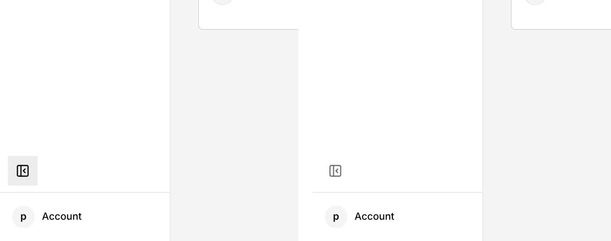
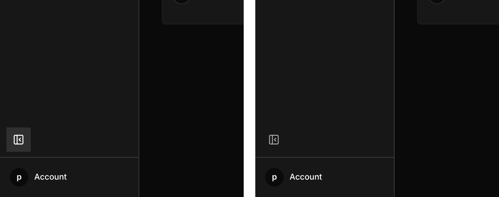
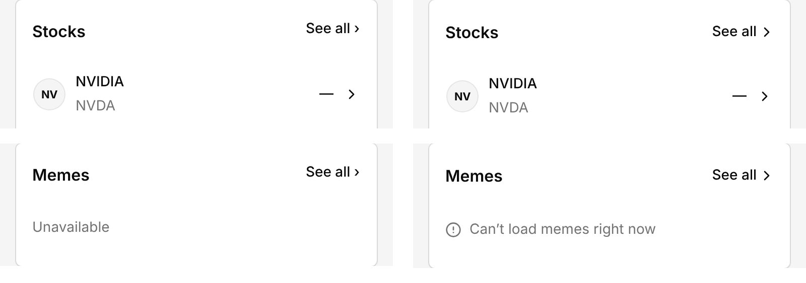
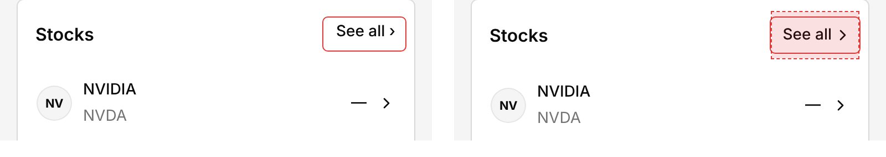
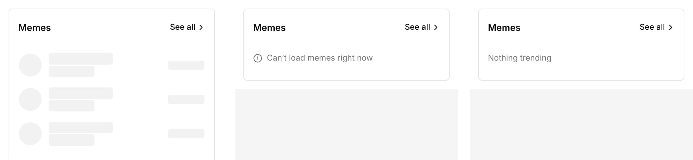

# Design review: factory bot output, October 2026

Branch `design/review`. Shots in `design-jam/shots/review/`.

## Scope and method

- Window: work merged to `jessepollak/home` main from 2026-10-01 to 2026-10-31 (main tip 87d35c1, 2026-10-23).
- Source: git only, read-only on GitHub. `git fetch --shallow-since=2026-09-30 upstream main`, then `git log upstream/main --since=2026-10-01`.
- How bot work was identified. Labels are not visible in git, and the repo squash-merges, so only 6 of the 267 commits are merge commits. A commit counts as factory work when its message carries the trailer `Co-authored-by: jessepollakj` (the factory account) or its author is `jessepollakj`. 199 of 267 commits match (squash commits authored as `j <j@pollak.io>` with that trailer, plus 7 authored directly by `jessepollakj`). The rest are Jesse's own commits without the trailer, and dependabot.
- 60 of the 199 touch `.tsx` under `apps/web/client` or `apps/web/components`. The most-churned UI files were `activity-panel.tsx` (13 commits), `shell.tsx` and `cash-overview.tsx` (12 each), `cash-experience.tsx` (10), `home-overview.tsx` (9), `finance-rows.tsx` (8).
- What I measured against: `docs/design-system/spec.md` (type, radius, motion, state and status-texture roles) and the owned components and their stories.
- How: Next dev on 3101 with `HOME_PLAYWRIGHT_SMOKE=1` and the repo's `installApiFixtures` Playwright fixtures (signed in, no database), Storybook on 6101. I took screenshots at 320, 390 and 1280 px in light and dark. I also ran a script that lists every interactive element smaller than 44 px in either direction, counting any `::before` hit-area extension. Surfaces checked: Home, Activity, Cash, Invest, Investments, Borrow, Card and Account, plus the `home-overview`, `activity-ledger`, `navigation-desktop-rail` and `ui-load-error` stories.

## Findings, ranked by product impact

Impact is how much a fix would improve what a customer sees on a normal day, weighed against how often they see it.

| # | Finding | Where | Kind | Origin | Impact | Status |
| --- | --- | --- | --- | --- | --- | --- |
| 1 | The desktop Sidebar toggle sits in the pressed state all the time: a grey square in the rail's bottom corner. | `components/primary-navigation.tsx`, Button `navigation` variant | Broken state | Regression from #2124 (Oct 12), which added `aria-expanded:bg-state-pressed` to `navigation`. The toggle is `aria-expanded` whenever the rail is open, which is its resting state. | High: every desktop screen, both themes | Fixed |
| 2 | "See all ›" on the Invest shelves is a 30 px target, uses a typed `›` where every other row uses the Lucide chevron, and its padding is uneven (`pt-0.5 pb-1.5`). | `client/invest/discover-shelf.tsx`, Button size `card-action` | Tap target, drift | Present before the window; the file was reworked in #1736 (Oct 5) and kept it | High: the main way into Invest categories, three per screen | Fixed |
| 3 | The Discover shelf's loading and failed states are bare prose ("Loading", "Unavailable"). The spec bans loading prose and wants a skeleton, and wants Can't load to look like Can't load. | `client/invest/discover-shelf.tsx` | Weak state | Same as above; the category screen beside it already uses `ShimmerRows` and `LoadErrorCard` correctly | Medium-high: Memes is often slow or empty | Fixed |
| 4 | When market prices fail, every Invest row shows a bare dash (U+2014) with no Can't load signal. The spec says the dash treatment is replaced by Can't load (#2045). | `client/invest/discover-asset-row.tsx` | Weak state | Spec moved in #2157 (Oct 16); rows did not follow | Medium | Open |
| 5 | Cash hero shows "3.50% APY" in market-gain green; the Home row shows the same rate muted. The spec keeps gain colour for money-in amounts and price change. | `client/cash/cash-overview.tsx` lines 524, 818 | Colour drift | Pre-window, touched by #1305 and the #2203 and #2189 Cash passes | Medium: one more green on a quiet screen | Open |
| 6 | Activity dates break inside the time ("Sep 14, 12:00 / PM") when the value column is wide. | `components/finance-rows.tsx` row context, story `home-overview--cant-load` | Type, wrapping | #2164 and #2203 fixed clipping but not this break | Medium | Open |
| 7 | Home Can't load puts a bordered Alert inside the bordered balance Card, so there are two boxes for one message. | `client/balances/balances-cant-load.tsx` inside the Home hero | Spacing, nesting | #1854, #2236 | Medium-low: only on failure | Open |
| 8 | 24 hard-coded durations (`duration-150`, `duration-200`, `duration-[80ms]`) in 13 product files, against 7 uses of the motion tokens added in #2130. Button and the rail labels are the most visible. | `components/ui/button.tsx`, `components/primary-navigation.tsx` and others | Motion drift | #2130 added tokens without migrating callers | Low: invisible today, costly later | Open |
| 9 | Off-scale type: `text-[0.8125rem]` in the balance legend, `text-[1.05rem]` in the coverage table. Neither is a spec type role. | `components/signed-balance-bar.tsx`, `components/ui/coverage-table.tsx` | Type drift | Pre-window, kept by #1854 and #2236 | Low | Open |
| 10 | Activity section labels ("PENDING", "RECENT") are uppercase with wide tracking. That is not a spec type role, and other section headings use sentence case. | `client/activity/activity-ledger.tsx:383` | Type drift | Pre-window | Low | Open |
| 11 | Account country dots are 26 px buttons (31 of them). | Account page, coverage globe | Tap target | Pre-window | Low: decorative, labelled "illustrative" | Open, flagged to globe |
| 12 | The balance bar segments have a 24 px pointer target. | `components/signed-balance-bar.tsx` | Tap target | Pre-window | Very low: `aria-hidden`, and the 48 px legend does the same job | Accept |

Things the bot got right this month and should keep doing: the status texture system (#2157) is consistent across Activity; declined and reversed card amounts are muted with no sign; Home is readable and tappable at 200% text (#2171); every row target on Home, Activity, Cash, Investments and Borrow is 44 px or more.

## Fixes on this branch

### 1. Sidebar toggle no longer looks stuck

A new Button variant, `rail-toggle`, has the neutral hover and pressed states but no Selected fill. The toggle keeps `aria-expanded` for screen readers. Corners are `rounded-lg`, the Controls radius, instead of `rounded-none`. `docs/design-system/theme.md` says why in one line.

| Light, before and after | Dark, before and after |
| --- | --- |
|  |  |

### 2. See all: 44 px target, real chevron, even padding

The `card-action` size is now a 32 px button with a `::before` that extends the hit area to 44 px, the same pattern `compact-touch` already uses. Padding is symmetric, and it uses `-me-2` so it works in right-to-left layouts. The `›` character is now `ChevronRight` with `data-icon="inline-end"`, and its right edge lines up with the row chevrons below. `card-action` has one caller, so nothing else moves. The `routing.pw.ts` selectors now use the name "See all".

The hit-area overlay: solid red is the visible button, dashed red is the touch area.

### 3. Discover shelf states follow the status texture spec

- Loading: three `ShimmerRows` shaped like the loaded rows, with `role="status"` and screen-reader text "Loading memes". No prose.
- Failed or unavailable: the Can't load mark (muted `CircleAlert`) and "Can't load memes right now".
- Empty: "Nothing trending" replaces "None trending".
- New stories: `invest-discover-shelf--loading`, `--cant-load` and `--nothing-trending`, with play checks.

Before, the shelf said "Unavailable" in grey (see the lower pair in the See all comparison above). After:

## Proposed monthly review checklist

Run on the first Monday of each month against the last 30 days of factory merges. It takes about two hours, and most of it can be scripted.

1. List the work. `git log upstream/main --since=<30 days ago> --format='%h %s'`, then keep commits with the `Co-authored-by: jessepollakj` trailer and sort them by UI files touched. Review the ten most-churned `.tsx` files first.
2. Screens. Capture Home, Activity, Cash, Invest, Borrow, Card and Account at 320, 390 and 1280 px, in light and dark, with the Playwright fixtures. Put them next to last month's set.
3. Tap targets. Run the 44 px audit script (it counts `::before` extensions). Anything new under 44 px needs a reason.
4. Resting states. For every disclosure, toggle and tab, check that its resting state looks at rest. `aria-expanded` or `aria-pressed` on a control that is "open" by default is the pattern that broke the rail toggle.
5. Status textures. Look at each surface in loading, Can't load, failed and empty states (stories first). No loading prose, no bare dash placeholder, no "Unavailable" on its own, and at most one loud texture per surface.
6. Colour. Count the colour on each screen. Gain green only for money in and price change; Base blue only for the one primary action.
7. Token drift. Grep for `duration-[0-9]`, `text-\[`, `rounded-none` on controls and `transition-all`. The count should only go down. Lint already blocks raw spinners, local number formatting and real waits in stories (`home/no-raw-style-utilities`, `home/no-local-formatting`, `home/no-real-waits`; list from the motion session).
8. Type. Spot-check against the five spec roles (Amount, Heading, Body, Label, Metadata). No uppercase, no off-scale sizes.
9. Wrapping. Check 320 px and 200% text for breaks inside dates, amounts and names.
10. Write it up. One table like the one above, the top three fixed in one PR, and the rest filed against the area's debt issue (per `docs/work-sizing.md`).

## Checks

- `bun install --frozen-lockfile`: pass, 833 packages, no lockfile change.
- `DATABASE_URL="" bun lint`: pass, exit 0, no warnings (oxlint `--deny-warnings`, including `home/no-comments`).
- `bun typecheck`: pass, exit 0. The default Node heap ran out of memory with five jams sharing the box, so it ran with `NODE_OPTIONS=--max-old-space-size=6144`.
- `bun run gates`: pass, exit 0 (design-spec, styling and library catalog gates included).
- Not run: the full `test:stories` and Playwright suites, which are too heavy to run alongside four other jams. The `routing.pw.ts` selector change is mechanical.

## Cool finds

- Hit-area audit in one `page.evaluate`: query `a[href], button, [role=button], [role=tab], input, select`, read `getBoundingClientRect()`, then add the `::before` insets from `getComputedStyle(el, "::before")` when its `position` is `absolute`. This catches 32 px buttons that are really 44 px. The script is in this session's scratchpad (not committed): it imports `installApiFixtures` and `seedSignedInSession` from `apps/web/tests/browser/fixtures/api.ts` and runs with `bun`. It drives signed-in fixture pages without the agent-browser setup.
- Visual hit-area overlay for before and after shots: `[data-slot=button]{outline:1px solid red} [data-slot=button]::before{background:rgba(220,38,38,.14);outline:1px dashed red}`.
- `ShimmerRows` in `client/home/panel-shared.tsx` and `StatusMark` in `components/ui/status-texture.tsx` cover loading and Can't load in a few lines. Use them instead of writing prose.
- The `compact-touch` and `card-action` sizes show the house pattern for a small visual button with a 44 px target: `relative` plus `before:absolute before:-inset-y-1.5 before:content-['']`.

## For the others

- motion: the repo has 24 hard-coded durations in 13 files and only 7 uses of `duration-fast` or `duration-base`. Button (`duration-150`) and the rail labels (`duration-[80ms]`, `duration-[100ms]`) would be good first callers for your tokens.
- globe: the Account coverage globe's 31 country buttons are 26 px. If your globe has tappable countries, give them a 44 px hit area or a list fallback.
- gallery and mark: any new rail or header control should use `rail-toggle` or `ghost`, not `navigation` with `aria-expanded`, or it will rest in the pressed fill.
- everyone: `git log --since=... | grep 'Co-authored-by: jessepollakj'` is how to tell factory work from Jesse's own commits.

## Borrowed from

- motion: I point the checklist's token-drift step and the "For the others" note at their duration and easing table in `components/explorations/money-motion/tokens.ts` instead of proposing new values.
- motion: their list of the lint rules that catch design-lane code (`home/no-real-waits`, `home/no-local-formatting`, `home/no-raw-style-utilities`) goes in checklist step 7 as a quick pre-check before a design PR.
